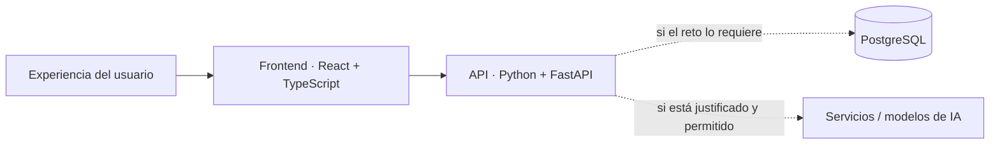

# ◈ BOX-IT

### CAJATHON 2026 · ÁREA DE NEGOCIOS

**Un equipo. Un desafío por descubrir. Una solución por validar.**

[**Documentación**](docs/README.md) · [**Roadmap**](docs/02-organizacion/ROADMAP-PREPARACION.md) · [**Tareas**](https://github.com/Wilder-reyes/BOX-IT-CAJATHON-2026/issues) · [**Cómo colaborar**](CONTRIBUTING.md)

---

> [!IMPORTANT]
> **El desafío de Negocios aún no ha sido comunicado.** BOX-IT no ha seleccionado un problema ni construido una solución específica. Lo que encuentres aquí es preparación general, investigación, organización y herramientas para actuar cuando se reciba el enunciado oficial.

## ✦ Nuestra misión

Prepararnos para transformar un desafío real de negocio en un **prototipo funcional, útil y validado**, aplicando ingeniería, análisis de datos, diseño de producto y pensamiento estratégico.

**Nuestra forma de trabajar:** entender primero → definir el impacto → construir lo necesario → demostrar con evidencia.

## 🧭 Empieza aquí

| Explorar | Qué encontrarás | Acceso |
|:--|:--|:--|
| **01 · Bases** | Criterios, fechas, requisitos y propiedad intelectual | [Ver bases](docs/01-bases/RESUMEN-EJECUTIVO.md) |
| **02 · Organización** | Reunión inicial, responsabilidades y decisiones | [Ver organización](docs/02-organizacion/ROLES-Y-REUNIONES.md) |
| **03 · Roadmap** | Qué preparamos ahora y qué reservamos para la final | [Ver roadmap](docs/02-organizacion/ROADMAP-PREPARACION.md) |
| **04 · Arquitectura** | Opciones técnicas, no tecnología obligatoria | [Ver stack](docs/02-organizacion/STACK-PROPUESTO.md) |
| **05 · Evidencias** | Cómo registrar el trabajo y validar resultados | [Ver guía](docs/05-evidencias/PLAN-DE-TRAZABILIDAD.md) |
| **06 · Trabajo abierto** | Actividades con responsables y revisiones | [Ver Issues](https://github.com/Wilder-reyes/BOX-IT-CAJATHON-2026/issues) |

📚 [**Índice completo de documentación**](docs/README.md)

## 👥 El equipo

Cuatro perfiles complementarios, una decisión colectiva sobre el liderazgo.

| Integrante | Área | Contribución propuesta |
|:--|:--|:--|
| **Wilder** | Desarrollo tecnológico | Coordinador registrado · arquitectura, backend e IA |
| **Sheila** | Desarrollo tecnológico | Full-stack · integraciones y QA |
| **Flor** | Innovación y negocio | Investigación · estrategia, producto y UX |
| **Andrea** | Innovación y negocio | Indicadores · análisis de negocio y validación |

> **Coordinación ≠ liderazgo general.** La persona que liderará BOX-IT se elegirá en reunión, con acuerdo del equipo. Las funciones anteriores son propuestas, no asignaciones definitivas.

## 🗓️ Nuestro recorrido

| Etapa | Fechas 2026 | Enfoque |
|:--|:--|:--|
| **01 — Preparación** | 16–20 nov. | Conocernos, investigar, revisar bases y organizar herramientas |
| **02 — Solution Concept** | 20–24 nov. | Interpretar el **reto oficial**, definir impacto y factibilidad |
| **03 — Selección** | 25–30 nov. | Evaluación de conceptos y anuncio de 12 finalistas |
| **04 — Inmersión técnica** | 1 dic. | Preparación según recursos y restricciones comunicadas |
| **05 — Build & Validate** | 3–4 dic. | Construcción presencial, pruebas, evidencia y demostración |

Fechas sujetas a cambios comunicados por la organización. Consulta el [roadmap detallado](docs/02-organizacion/ROADMAP-PREPARACION.md).

## 🧩 Arquitectura de referencia

Este es un **stack provisional**, elegido por las competencias del equipo. No supone que el desafío necesite web, base de datos, agentes o IA. [Detalles y criterios de selección](docs/02-organizacion/STACK-PROPUESTO.md).

## ✅ Cómo avanzamos

| Actividad | Estado | Seguimiento |
|:--|:--|:--|
| Revisión de bases y propiedad intelectual | Documentación inicial lista; pendiente de revisión | [#1](https://github.com/Wilder-reyes/BOX-IT-CAJATHON-2026/issues/1) |
| Factibilidad técnica genérica | Por acordar con Sheila | [#2](https://github.com/Wilder-reyes/BOX-IT-CAJATHON-2026/issues/2) |
| Investigación pública de Caja Trujillo | Por acordar con Flor | [#3](https://github.com/Wilder-reyes/BOX-IT-CAJATHON-2026/issues/3) |
| Diccionario de KPI y validación | Por acordar con Andrea | [#4](https://github.com/Wilder-reyes/BOX-IT-CAJATHON-2026/issues/4) |
| Primera reunión y elección del liderazgo | Pendiente | [#5](https://github.com/Wilder-reyes/BOX-IT-CAJATHON-2026/issues/5) |
| Interpretación del reto oficial | **Bloqueada hasta su comunicación** | [#6](https://github.com/Wilder-reyes/BOX-IT-CAJATHON-2026/issues/6) |

Las fechas y responsabilidades deben confirmarse en equipo; el tablero de GitHub Projects es **opcional y aún no está creado**. Los [Issues](https://github.com/Wilder-reyes/BOX-IT-CAJATHON-2026/issues) son la fuente de seguimiento.

## 🔐 Reglas de colaboración

- **Nada confidencial en este repositorio público:** ni datos de clientes, credenciales, documentos restringidos o detalles del reto cuya publicación no esté autorizada.
- **No simular resultados como reales:** distinguir métricas medidas, hipótesis y estimaciones.
- **Respetar la propiedad intelectual:** inventariar componentes preexistentes, licencias y titulares.
- **Evidenciar trabajo presencial:** la funcionalidad crítica nueva o adaptación sustantiva deberá desarrollarse y demostrarse durante las jornadas del 3 y 4 de diciembre.
- **Revisar antes de integrar:** cada cambio debería pasar por Pull Request y revisión de otro integrante.

Consulta [CONTRIBUTING.md](CONTRIBUTING.md) y la [síntesis de propiedad intelectual](docs/01-bases/PROPIEDAD-INTELECTUAL.md).

---

**BOX-IT · Preparar con criterio. Construir con propósito. Validar con evidencia.**

Proyecto independiente de un equipo participante. No es un repositorio oficial de Caja Trujillo.

