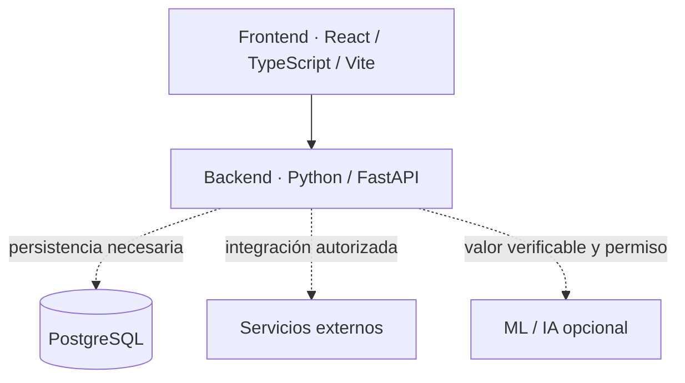

# 🧱 Stack tecnológico de referencia

[← Documentación](../README.md) · [Roadmap](ROADMAP-PREPARACION.md)

> [!IMPORTANT]
> **No conocemos el desafío oficial.** Este stack es una opción inicial basada en conocimientos compartidos por Wilder y Sheila; no es una arquitectura final ni implica que necesitemos una web, base de datos o IA.

## Arquitectura modular (si el reto requiere aplicación web)

| Componente | Opción inicial | Alternativa o condición |
|:--|:--|:--|
| Interfaz | React + TypeScript + Vite | Puede no requerirse frontend |
| Estilos | Tailwind CSS | CSS nativo si es más simple |
| API | Python + FastAPI + Pydantic | Node.js/Express si conviene a la integración |
| Almacenamiento | PostgreSQL | Archivos sintéticos/SQLite si la escala y el caso lo permiten |
| Pruebas | pytest, Postman, Vitest | Según stack elegido |
| Frontend deployment | Vercel | Solo con datos y permisos adecuados |
| Backend deployment | Render | Alternativas según restricciones |
| Docker | Condicional | Para reproducibilidad cuando sea útil |
| IA / agentes | Por definir | No introducir sin justificar impacto, riesgo y costo |

## Lista de decisión al conocer el reto

1. ¿Qué debe demostrar exactamente el prototipo?
2. ¿Hay usuarios que necesiten una interfaz o basta con un proceso automatizado?
3. ¿Cuáles son los datos permitidos y las restricciones de IA/SaaS?
4. ¿Se necesitan integraciones? ¿Están autorizadas?
5. ¿Qué parte puede construirse y probarse **en dos jornadas**?
6. ¿Qué arquitectura maximiza simplicidad, trazabilidad y fiabilidad?
7. ¿Cómo se medirá el KPI con evidencia honesta?

## Preparación permitida

Configurar herramientas, revisar documentación, probar entornos neutros y definir convenciones. **No desarrollar de antemano la funcionalidad crítica que deberá construirse durante el hackathon.**

## Responsables técnicos sugeridos

Wilder: arquitectura, módulos especializados y eventual IA. Sheila: ingeniería full-stack, integraciones y calidad. Flor y Andrea: definición de necesidades, criterios de aceptación y validación con el negocio. Todo sujeto al acuerdo del equipo.
